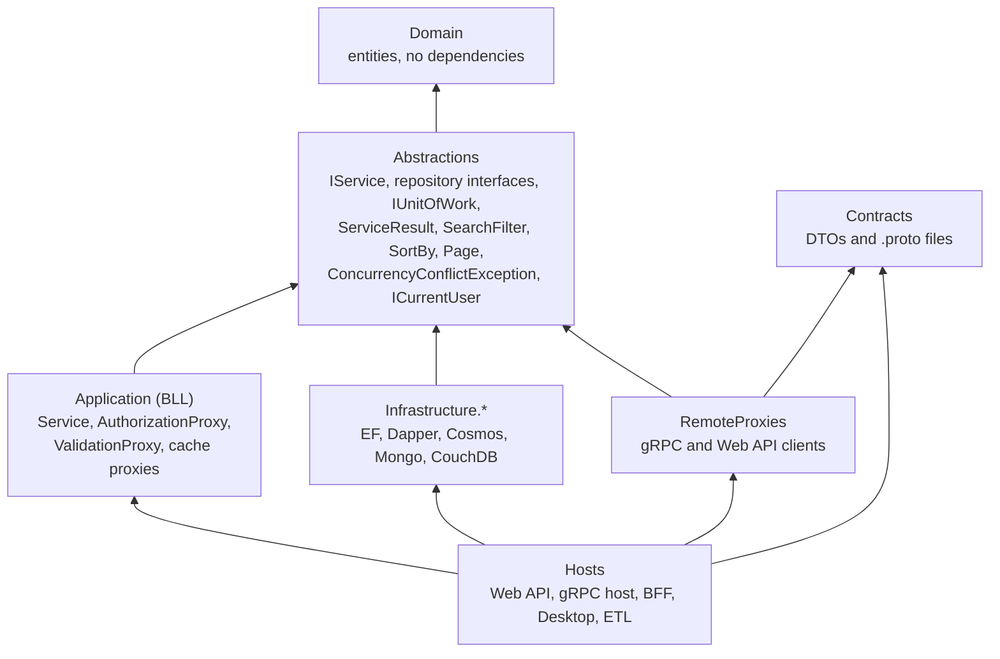

# Layers and dependency direction

[Back to the index](README.md)

The design uses dependency inversion with **one** shared `Abstractions` library. The diagram shows the
runtime call flow; this page shows the compile-time references, which the diagram does not.

An arrow means "references". Hosts reference only what they wire up; for example the ETL host
references `RemoteProxies` but not the BLL or DAL.

## Rules

1. **The interfaces live in `Abstractions`, not in the BLL.** Clients without a BLL (ETL, BFF, web UIs)
   need `IService` for the remote proxies. If it lived in the BLL, they would have to reference
   `Service` and its proxies too, which would break "the ETL has no BLL" at the package level.
2. **The BLL and the DAL never reference each other.** Both reference `Abstractions`. Repository code
   can't call business logic, and the BLL compiles without EF, Dapper or any database package, so the
   compiler enforces "no direct database access from the BLL".
3. **Shared types are defined in `Abstractions`** and used by the implementations:
   `ConcurrencyConflictException` is defined there and thrown by the data access implementations;
   `SearchFilter` and `SortBy` are used by both service methods and repositories.
4. **`Contracts` never references `Domain`.** Domain entities never cross the wire; the remote proxies
   and the API hosts map between contracts and entities, and contracts are versioned on their own.
5. **Hosts are the composition roots.** They are the only projects that reference everything they
   wire together.
6. **The desktop host references everything**, because it has its own BLL and DAL for offline use.

## Why one library, not two

A split into service abstractions and data abstractions is possible later; only types would move.
It isn't worth it now: `SearchFilter` and `SortBy` are used on both sides, and a client that can see
repository *interfaces* (not implementations) gains nothing it can misuse.

Precedents for the pattern: `Microsoft.Extensions.Logging.Abstractions` and
`Wolfgang.Etl.Abstractions`.
